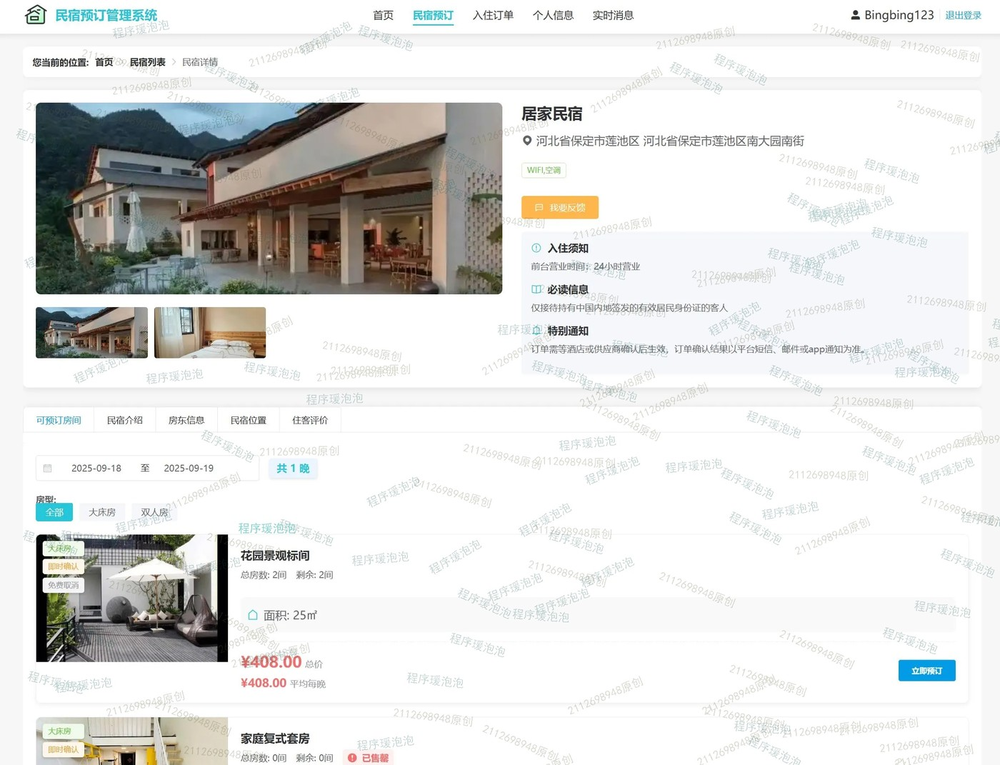
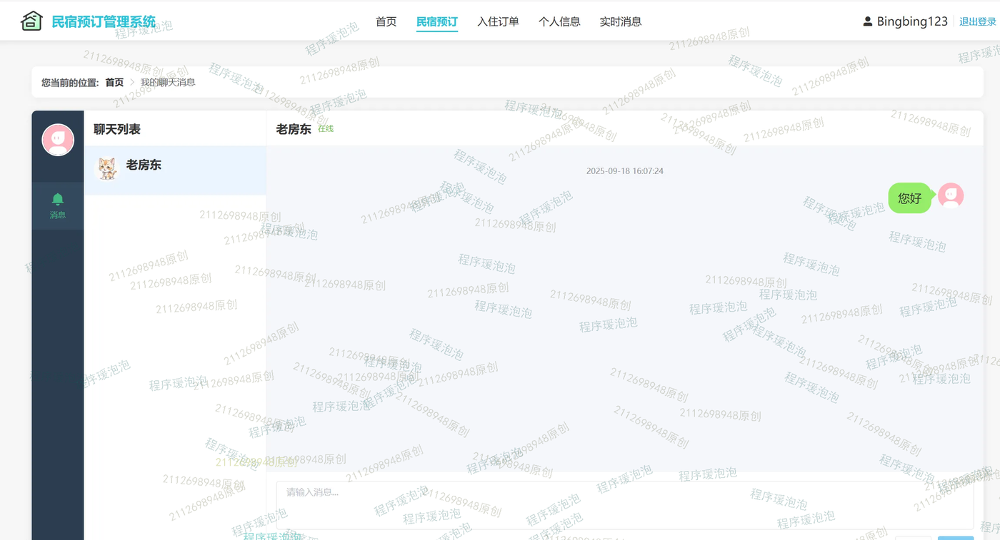
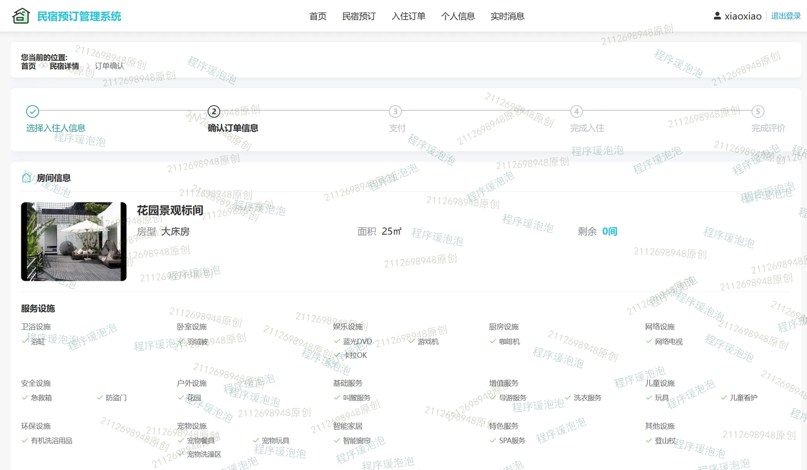
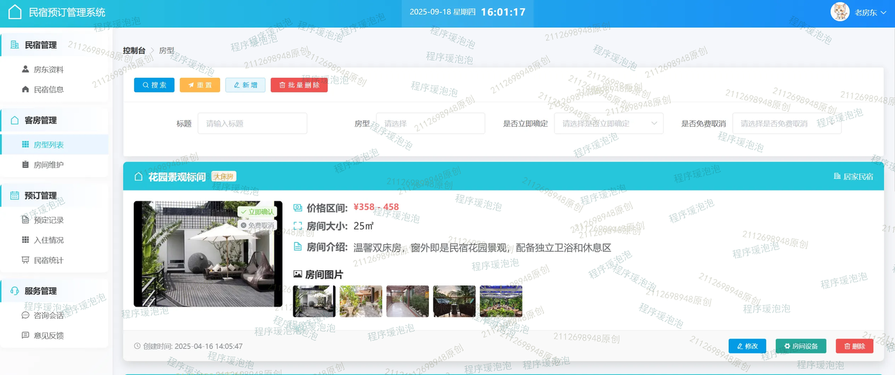
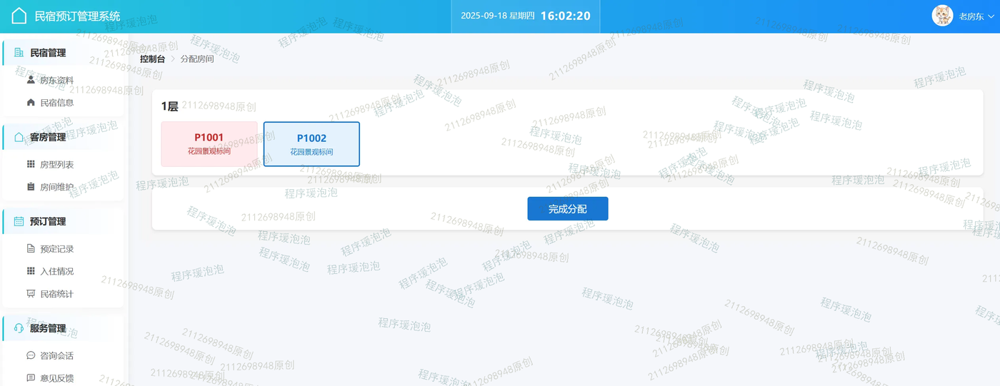
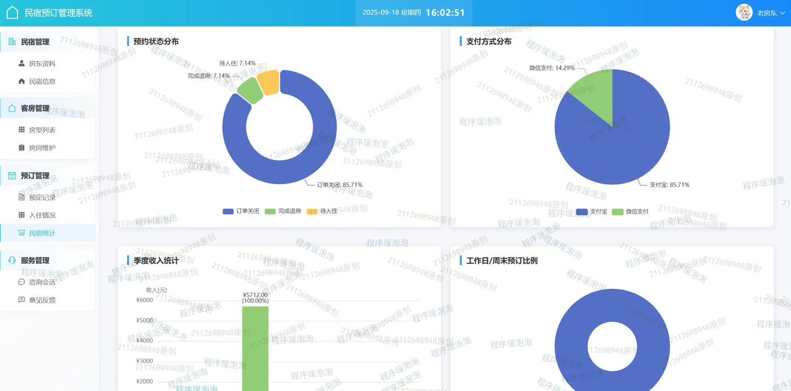
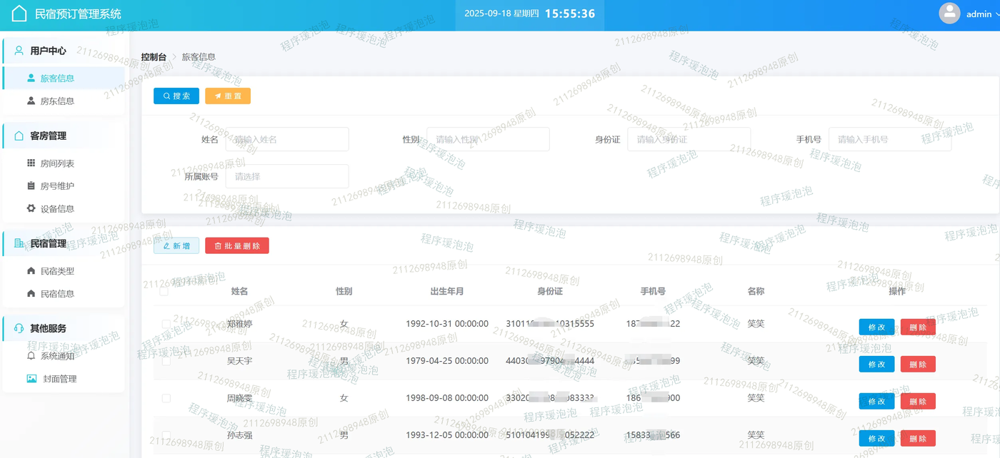
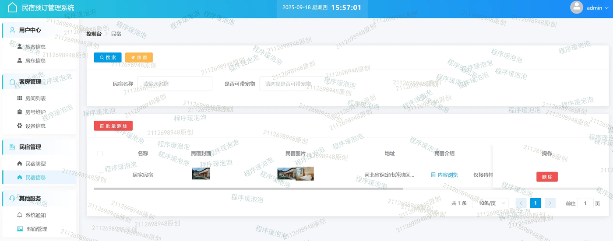

# HotelStayAppointCore
民宿预定系统
亮点：WebSocket及时通讯、腾讯地图API、支付宝沙盒支付、ECharts图形化分析、协同过滤推荐、腾讯地图定位、QQ邮箱通知、预订入住业务闭环、房价与优惠管理
角色：民宿管理员、房东、用户；

所有源码均本人开发，项目是前后端分离的，所有的项目都具备了完整的业务逻辑，不仅仅局限于基础的增删改查（CRUD）操作，系统亮点众多。

本文注重于计算机毕业设计选题指导，列出题目均有源码， 大家可以去【公众号】(毕业终点站)获取或者加我【qq】(2112698948)提意见(别忘记Star哟)。备注：git

声明：仅用于学习使用，请勿用于任何商业行为！

1.系统非商用，非开源，非无偿。

2.由本人开发，如需源码，请联系以下方式，qq:2112698948。 https://home.biyecode.com/

3.项目有很多，并未全部上传，如果未找到想要的，可直接咨询。

# 民宿预定管理系统

基于用户前台 + 房东端 + 管理后台的民宿预订平台，把民宿浏览推荐、在线预订支付、房间分配办理入住和经营统计放在一处。三类角色各司其职：用户挑选与预订，房东维护房源并办理入住，管理员维护平台基础数据。

## 项目简介

- **架构**：B/S、MVC、前后端分离，民宿管理员、房东、普通用户三类角色
- **开发环境**：IDEA、JDK17、Maven、MySQL、Node.js
- **后端技术**：Java、Spring Boot 3.3.1、Spring MVC、MyBatis-Plus、MySQL、JWT、WebSocket、Spring Mail、支付宝 SDK
- **前端技术**：Vue 2.6、Vue CLI 5、Element UI、Vue Router、Vuex、Axios、ECharts、富文本编辑器
- **业务集成**：支付宝沙盒支付、腾讯地图、QQ 邮箱通知、Spring 定时任务

## 系统亮点

- **协同过滤推荐**：结合已完成订单与评分构建用户—民宿评分矩阵，通过余弦相似度计算相似用户并预测民宿得分；缺少历史记录时结合评分和预订量排序，帮助用户发现合适的民宿。
- **支付宝沙盒支付**：预订订单接入支付宝沙盒支付与支付结果检测，把下单、付款和订单状态更新串联起来，便于演示预订支付流程。
- **腾讯地图定位**：后台支持地图选点与地址定位，前台详情展示民宿位置，方便房东维护地址、用户了解住宿地点。
- **QQ 邮箱通知**：通过邮件发送预订信息和入住提醒，配合定时通知任务，让用户及时了解住宿安排。
- **WebSocket 在线咨询**：支持用户与后台实时聊天并查看历史消息，方便预订前咨询和入住事项沟通。
- **预订入住流程**：覆盖日期选房、提交订单、支付、取消申请、分配房间、办理入住、退房及评价，联动订单与客房状态。
- **房价与优惠管理**：支持房型价格及优惠设置，结合预订日期展示房源和价格，满足民宿日常经营维护需求。
- **ECharts 经营分析**：展示订单状态分布、收入、房晚数、入住率和平均入住时长等统计，帮助管理人员了解民宿经营情况。

## 系统功能

### 普通用户端

- 注册登录、邮箱找回密码
- 民宿浏览与搜索筛选、民宿推荐、民宿详情（房型房价、配套设施、地图位置、评价）
- 在线预订、支付宝沙盒支付、我的订单与取消申请、订单评价
- 旅客管理、在线聊天、公告浏览、意见反馈、个人中心

### 房东端

- 民宿维护、房型管理、房间管理、房价设置
- 订单管理、入住办理（分配房间）、退房办理、经营统计
- 在线咨询、个人中心

### 管理员端

- 旅客管理、房东管理、民宿管理、房间管理
- 预订管理、入住查询、民宿统计
- 公告管理、轮播管理、反馈管理

## 系统截图

> 顶部为用户首页总览。截图按用户、房东、管理员三个角色依次展示。用户与房东的在线咨询为同一沟通功能的不同视角，仅展示用户端画面。

### 一、普通用户端

**民宿列表与推荐**

按目的地、入住日期和民宿风格筛选，民宿卡片展示推荐/确认订单标签、房型、价格、地址和设施标签，列表综合评分与预订量给出推荐。

**民宿详情与地图位置**

详情页展示民宿图片、地址、WIFI 与入住须知，按可订房间/民宿介绍/房东信息/民宿位置/住宿评价分栏；选择日期后可见房型价格与立即预订。

**实时在线咨询**

用户可与房东实时聊天、查看历史消息，左侧聊天列表显示会话与在线状态。

**订单确认与预订流程**

下单按"选择入住人 → 确认订单信息 → 支付 → 完成入住 → 完成评价"推进，确认页展示房型信息与完整服务设施清单。

### 二、房东端

**房型与房价设置**

房东维护房型卡片，配置价格区间、房间大小、介绍与图片，并可进入房价设置维护价格与优惠。

**办理入住与分配房间**

按楼层展示房间号方块，从可用房中选择并为预订旅客分配房间，完成入住办理。

**经营统计分析**

以环形图和柱状图展示预订状态分布、支付方式分布（支付宝/微信支付）、季度收入和工作日/周末预订比例。

### 三、管理员端

**旅客信息管理**

按姓名、性别、身份证、手机号等条件查询旅客，支持新增、修改、删除和批量删除。

**民宿信息管理**

维护民宿名称、类型、封面、图片、地址和介绍，支持新增与删除民宿。

---

文档展示 10 张截图，需要了解更多，请联系我。
